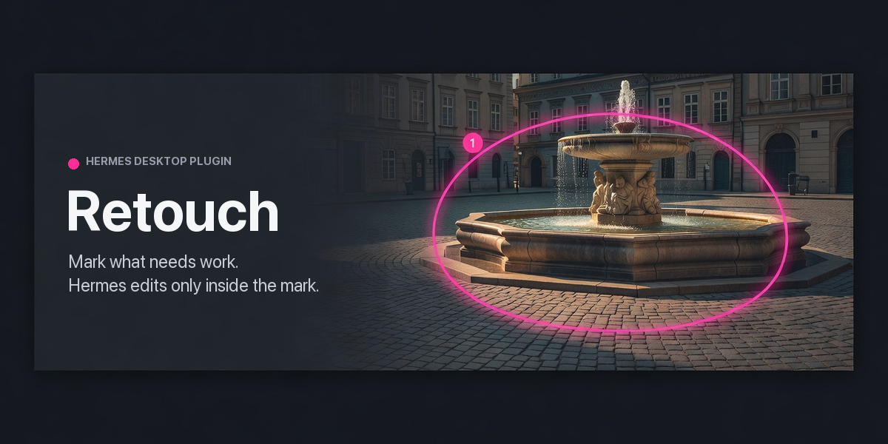

# Retouch



Mark the parts of an image that need work, leave a note on each mark, and Hermes fixes only those
areas. Every edit is checked pixel by pixel to change nothing outside its mark, saved as a new
version, and reviewed by you in that mark's own thread.

Retouch is a Hermes plugin with two halves: a pane in the Hermes Desktop app where you draw and
review, and four agent tools Hermes uses to do the work.

## What it does

- **Marks.** Draw with the pen, a box, an ellipse or a lasso, or drop a note at a spot. Each mark
  has an intent (fix, remove, enhance, ask) and a note in your own words. A pen stroke whose ends
  meet is a loop: the pane tints its inside, because Hermes may change everything inside it.
- **One thread per mark.** Send the marks and Hermes works on them in the background (one subagent
  per Send; the chat shows one line and the pane shows progress).
  Its replies, questions and your answers stay attached to the mark they are about.
- **Edits stay inside the marks.** Every result is blended through the mark's mask and compared
  with the previous version. An edit that changes even one pixel outside its mark is refused and
  never saved.
- **Three ways to edit.**
  - `adjust`: local tonal and privacy operations (exposure, brightness, contrast, saturation,
    warmth, grayscale, sharpen, denoise, blur, pixelate, redact). Tonal changes fade toward the
    mark's edge so no outline shows; privacy operations cover every pixel of the mark.
  - `generate`: repaints the marked area with your configured image model, for removing or
    replacing things.
  - `from_file`: takes a full-size copy the agent edited another way (saved in the project's work
    folder) and keeps only the marked area.
- **Honest review.** Hermes has to say what is still visibly wrong after each edit, and the pane
  shows it as "Still visible: …". When a removed object continues past the edge of its mark, the
  edge check says so whatever Hermes reports, and suggests drawing a bigger mark.
- **Versions.** Each edit is a new version and none is ever deleted. In a mark's bubble you can
  Accept it, ask for more work, Revert it, or close it as won't fix. **Undo** and **Redo** in the
  header (⌘Z, ⇧⌘Z) step the picture back and forward. The strip above the image lists the original
  and every edit: click one, or press **[** and **]**, to look at it without changing anything;
  **H** hides the mark outlines; the strip collapses to a small pill when it is in the way.
- **Save.** PNG, JPEG or WebP, written as a new file. Your original is never modified. GPS data
  and embedded file names, descriptions and comments are stripped; the color profile is kept.
  While you are looking at an earlier version, Save writes that version.

## Requirements

- Hermes `>= 0.22.7` and the Hermes Desktop app. Images are opened and marked in the pane.
- For removals and replacements (`generate`): an image generation provider configured in Hermes.
  Tonal fixes and privacy edits work without one.
- HEIC photos open when `pillow-heif` is installed (Hermes ships it on Python 3.14 and newer).

## Install

From the catalog, once listed:

```bash
hermes plugins install retouch
```

From source:

```bash
git clone https://github.com/Lyfae/hermes-retouch
ln -s "$PWD/hermes-retouch" ~/.hermes/plugins/retouch
hermes plugins enable retouch
```

Then turn on the Desktop half in the app: **Capabilities → Plugins → Retouch**. Nothing opens by
itself: press **⌘⇧E**, click the image button in the title bar, or ⌘K → "Retouch: open / close".
The window docks to the right of the chat; the same toggle, ⌘W or its × closes it.

After updating the plugin, restart the gateway (`hermes gateway restart`). The pane's backend
routes are loaded once per gateway process.

## Using it

1. Open an image in the Retouch window: the button, drag and drop, paste with ⌘V, or **Screenshot**.
   Screenshot appears only when the gateway runs on this Mac: it opens the system region picker,
   and the capture lands as a *scratch* project ("Screenshot · kept once you mark, edit or save
   it"). Marking it, editing it, **Keep** or **Save** makes it permanent; **Discard** deletes it.
   Scratch projects you never marked, edited or kept are deleted a day later, the next time you
   press Screenshot. Elsewhere, ⌘⇧⌃4 copies a region of the screen; paste it with ⌘V.
2. Pick a tool from the toolbar: Select **V**, Pen **P**, Box **R**, Ellipse **E**, Lasso **L**,
   Note **T**. Draw on the image, choose an intent, write what you want, and press ⌘↩.
3. Click **Send**. The pane asks Hermes in the open chat to work on your marks.
4. Click a mark's number to see Hermes's reply, the result and any warnings. Accept it, or say what
   is still wrong and send it back. Step through the versions with **[** and **]**, hide the
   outlines with **H**, and press Esc to return to the current picture.
5. **Save ▾** writes the finished image.

Open marks can be moved with Select; once sent, an edit belongs to that outline.

## Agent tools

| Tool | What it does |
| --- | --- |
| `retouch_get` | Reads a project: its marks, notes and threads, with an overview of the image and a close-up of each mark. |
| `retouch_edit` | Edits one mark with `adjust`, `generate` or `from_file`, and returns the pixel proof, the edge check and a before/after review image. |
| `retouch_reply` | Posts Hermes's reply on a mark, with its status and what is still visibly wrong. |
| `retouch_export` | Writes a version (the current one by default) to the project's exports folder, and nowhere else. |

Only you close a mark. Hermes can mark it as working, ready for review, or a question for you.

## Data, network and privacy

- Projects, versions, crops, review images and exports live in
  `<HERMES_HOME>/plugin-data/retouch/`, separately for each Hermes profile.
- **Your chat model sees the picture.** Every `retouch_get` sends a downscaled overview of the
  whole image plus a close-up of each mark to your chat model's provider, and every `retouch_edit`
  sends a before/after strip. Each Send starts one background subagent to do the work; if you
  configured delegation to use a different model or provider, the pictures go there too.
- `generate` additionally sends a crop of the area around the mark to Hermes's
  `image_generate` tool, which forwards it to the image provider you configured. Retouch then
  downloads the result: only over https, only from a public address, at most 40 MB. Your provider's
  own data retention applies; some providers return results at public URLs, so don't use `generate`
  on images you can't share with your provider.
- Text inside a picture is treated as picture content. Hermes is told never to follow it, and the
  tools cannot read or write outside the project: `from_file` reads only the project's `work`
  folder and exports go only to its `exports` folder.
- **Screenshot** (macOS, local gateway only) runs the system `screencapture -i` picker on the
  machine the gateway runs on and reads the one file it writes to a temporary folder, for at most
  55 seconds. This is Retouch's only subprocess; nothing is captured without you choosing the
  region, and the pane hides the button when your gateway is remote. macOS asks once for Screen
  Recording permission, and because Hermes starts its gateway through `osascript`, the permission
  it asks for covers `osascript` as a whole. If you would rather not grant that, press ⌘⇧⌃4 and
  paste with ⌘V instead: it needs no permission. Untouched screenshot projects
  are the only thing Retouch ever deletes on its own (see Using it); Discard refuses a kept project.
- Retouch makes no other network calls and runs no other shell commands,
  stores no credentials and sends no telemetry.

## Development

```bash
uv run --no-project --python 3.11 --with "pillow==12.3.0" --with pytest pytest tests -q   # unit tests, declared floor
uv run --no-project --python 3.14 --with "pillow==13.0.0" --with pytest --with hypothesis pytest verify -q  # property checks
hermes plugins validate .
```

`verify/` holds Hypothesis checks of the two promises above (every pixel outside a mark untouched,
for generated images and marks; the mark/version state machine honest under generated sequences
of user and agent calls). `.hermes/skills/verify-retouch/SKILL.md` says when to run them and how
to read a failure.

The library lives in `retouch/` (geometry, compositing, operations, storage, the service), the
agent tools in `tools.py`, the pane's REST backend in `dashboard/plugin_api.py` and the pane in
`desktop/plugin.js`.

## License

MIT
